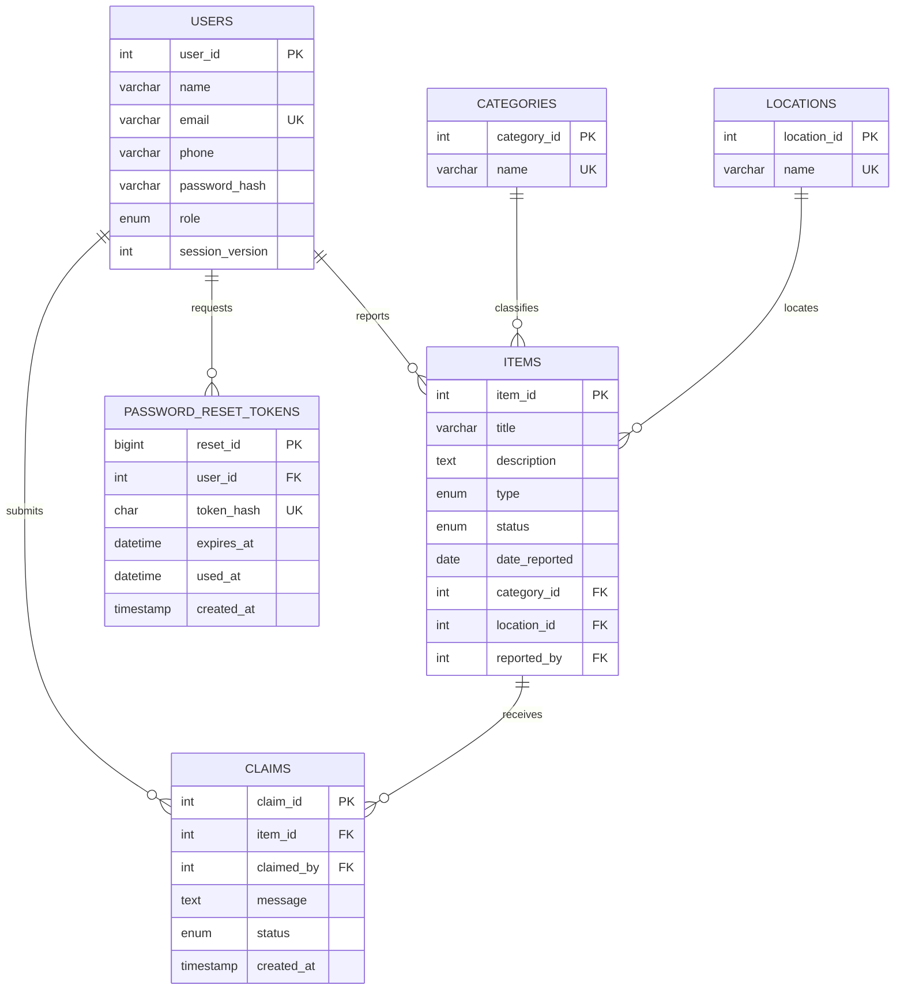

# Lost & Found ER Diagram

The SQL definitions and foreign-key constraints are in [`schema.sql`](schema.sql).

## সহজ বাংলায় সম্পর্কগুলো

| Table | কী রাখা হয় | সম্পর্ক |
| --- | --- | --- |
| `users` | Account এবং user/admin role | একজন user অনেক item report এবং অনেক claim করতে পারে। |
| `items` | Lost/Found report, তারিখ এবং status | প্রতিটি item একজন reporter, একটি category এবং একটি location-এর সঙ্গে যুক্ত। |
| `categories` | Wallet, Phone ইত্যাদি category | একটি category-তে অনেক item থাকতে পারে। |
| `locations` | Library, Canteen ইত্যাদি জায়গা | একটি location-এ অনেক item থাকতে পারে। |
| `claims` | মালিকানার দাবি, message এবং সিদ্ধান্ত | প্রতিটি claim একটি item এবং একজন claimant-এর সঙ্গে যুক্ত। একটি item-এ অনেক claim থাকতে পারে। |
| `password_reset_tokens` | Password reset link-এর hash, মেয়াদ ও ব্যবহারের সময় | প্রতিটি token একজন user-এর। Reset-এর পর পুরোনো login session আর কাজ করে না। |

`PK` হলো table-এর প্রতিটি record চেনার নিজস্ব ID। `FK` অন্য table-এর record-এর সঙ্গে সম্পর্ক রাখে। `UK` মানে একই value দ্বিতীয়বার রাখা যায় না, যেমন account email।

Claim প্রথমে `pending` থাকে। Admin approve করলে claim `approved` এবং item `claimed` হয়; ওই item-এর অন্য pending claim থাকলে সেগুলো `rejected` হয়। Reject করলে claim `rejected` হয় এবং open item open-ই থাকে।

Schema-তে item status হিসেবে `returned`-ও রাখা আছে; বর্তমান website-এ Returned করার আলাদা action তৈরি করা হয়নি।
